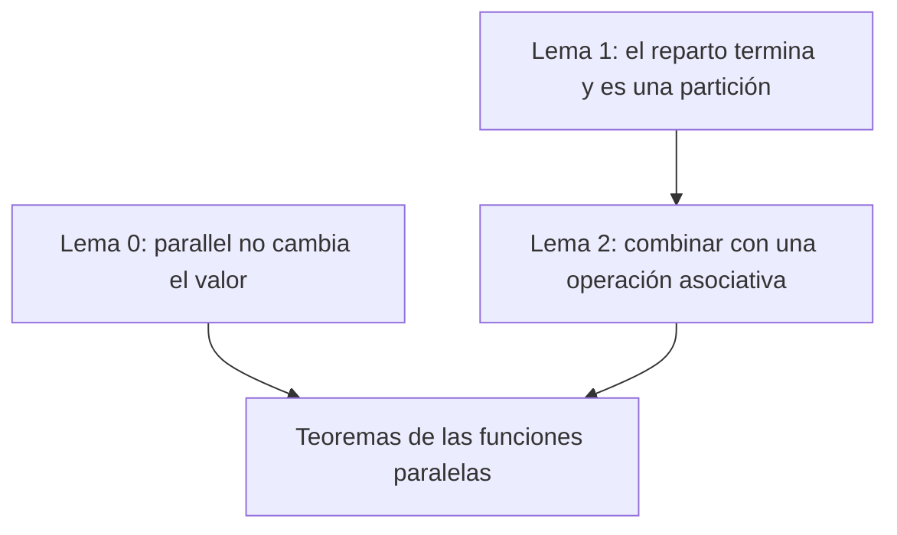

# Informe de corrección: simulación de partículas en paralelo

Este informe argumenta, con notación matemática, que cada función de `SimulacionParticulas` hace lo que pide el enunciado y que cada versión paralela da el mismo resultado que su versión secuencial. La estructura es la siguiente: primero se fija la notación y la especificación de cada función, luego se demuestran tres lemas generales sobre el reparto, y después esos lemas se aplican a cada función.

## 1. Notación

Un sistema de $n$ partículas es una sucesión $s = (p_0, \dots, p_{n-1})$ con $p_i = (r_i, v_i, m_i)$, donde $r_i, v_i \in \mathbb{R}^2$ son la posición y la velocidad y $m_i \ge 0$ es la masa. Para $0 \le a \le b \le n$, el tramo $[a, b)$ contiene los índices $a, a+1, \dots, b-1$ y tiene $b - a$ elementos. Se escribe $A \mathbin{+\!+} B$ para la concatenación de arreglos y $\lVert v \rVert = \sqrt{v_x^2 + v_y^2}$ para la norma.

Para un tramo, $\bigoplus_{i=a}^{b-1} g(i) = g(a) \oplus g(a+1) \oplus \dots \oplus g(b-1)$, y vale $e$ (el elemento neutro de $\oplus$) si el tramo está vacío.

Las demostraciones se hacen en aritmética exacta sobre $\mathbb{R}$. La sección 7 explica qué cambia con los números decimales del computador.

## 2. Especificación

Lo que debe cumplir cada función, escrito matemáticamente:

| Función | Especificación |
|---|---|
| `pasoSecuencial(s, dt)` | un arreglo $s'$ de $n$ elementos con $s'_i = (r_i + v_i \cdot dt,\ v_i,\ m_i)$ |
| `pasoSegmento(s, dt, a, b)` | el arreglo de $b - a$ elementos $(s'_a, \dots, s'_{b-1})$, vacío si $a \ge b$ |
| `energiaSecuencial(s)` | $E(s) = \sum_{i=0}^{n-1} \tfrac12\, m_i \lVert v_i \rVert^2$ |
| `masaTotal(s)` | $M(s) = \sum_{i=0}^{n-1} m_i$ |
| `centroDeMasaSecuencial(s)` | $R(s) = \dfrac{\sum_i m_i r_i}{M(s)}$ si $M(s) \neq 0$, y $(0, 0)$ si $M(s) = 0$ |
| las versiones `Paralelo` | el mismo valor que su versión secuencial, para todo $s$, todo $dt$ y todo umbral |

## 3. Tres lemas sobre el reparto

Las tres funciones repartidas tienen la misma forma: una función interna `aux(a, b)` que, si el tramo es pequeño, lo resuelve en secuencial y, si no, lo parte en `m = a + (b - a)/2` y combina `aux(a, m)` con `aux(m, b)`. Con $d = b - a$ y $u$ el umbral, un tramo es una **hoja** cuando $d \le u$ o $d \le 1$. La segunda condición hace que el reparto termine incluso con $u = 0$.

### Lema 0 (`parallel` no cambia el valor)

Si $e_1$ y $e_2$ no modifican ningún estado compartido, `parallel(e1, e2)` vale lo mismo que la pareja $(e_1, e_2)$, sin importar cuál de las dos termina primero.

*Argumento.* El código no tiene variables mutables ni ciclos, y ninguna función escribe en `s`: `slice` y `map` crean arreglos nuevos. Entonces `aux(a, m)` y `aux(m, b)` son funciones puras de datos que solo se leen, y la pareja que devuelve `parallel` es $(\texttt{aux}(a, m), \texttt{aux}(m, b))$ con la izquierda primero, en el orden en que se escribieron. $\square$

### Lema 1 (partición)

Para todo $0 \le a \le b \le n$ y todo umbral entero $u$, la ejecución de `aux(a, b)` termina, y los tramos de sus hojas son disjuntos dos a dos y su unión es $[a, b)$. Además, si $a < b$ todas las hojas son no vacías.

*Demostración.* Por inducción fuerte sobre $d = b - a$.

- **Caso base:** $d \le u$ o $d \le 1$. Es una hoja y su único tramo es $[a, b)$.
- **Paso:** $d > u$ y $d > 1$, es decir $d \ge 2$. Sea $m = a + \lfloor d/2 \rfloor$. Como $d \ge 2$, se cumple $1 \le \lfloor d/2 \rfloor \le d - 1$, y por tanto $a < m < b$. Los dos tramos nuevos tienen $\lfloor d/2 \rfloor < d$ y $d - \lfloor d/2 \rfloor = \lceil d/2 \rceil < d$ elementos, ambos no vacíos. Por hipótesis de inducción, las hojas de `aux(a, m)` forman una partición de $[a, m)$ y las de `aux(m, b)` una partición de $[m, b)$. Como $[a, m) \cap [m, b) = \emptyset$ y $[a, m) \cup [m, b) = [a, b)$, las hojas de `aux(a, b)` forman una partición de $[a, b)$. $\square$

El tamaño decrece estrictamente en cada partición y las hojas cubren el sistema exacto, así que **no se pierde ni se repite ningún elemento**. Sin la condición $d \le 1$, un tramo de un elemento con $u = 0$ daría $m = a$ y `aux(a, b)` se llamaría a sí misma con los mismos argumentos, y el lema fallaría.

### Lema 2 (combinar con una operación asociativa)

Sea $(M, \oplus, e)$ un monoide, es decir, $\oplus$ es asociativa y $e$ es su neutro. Sea $g$ una función de los índices $\{0, \dots, n-1\}$ en $M$. Si para toda hoja $[a, b)$ el resultado de la hoja es $\bigoplus_{i=a}^{b-1} g(i)$ y `aux` combina con $\oplus$ el resultado izquierdo y el derecho, en ese orden, entonces para todo $0 \le a \le b \le n$:

$$
\texttt{aux}(a, b) = \bigoplus_{i=a}^{b-1} g(i)
$$

*Demostración.* Por inducción fuerte sobre $d = b - a$, con el Lema 1 asegurando que termina.

- **Hoja:** vale por hipótesis.
- **Paso:** con $a < m < b$,

$$
\texttt{aux}(a, b) = \texttt{aux}(a, m) \oplus \texttt{aux}(m, b)
= \left(\bigoplus_{i=a}^{m-1} g(i)\right) \oplus \left(\bigoplus_{i=m}^{b-1} g(i)\right)
= \bigoplus_{i=a}^{b-1} g(i)
$$

La primera igualdad es el código (con el Lema 0 para la pareja), la segunda es la hipótesis de inducción y la tercera es la asociatividad generalizada: en una expresión con $\oplus$ asociativa, los paréntesis no cambian el valor. $\square$

Del lema se obtienen dos observaciones. Primero, **la asociatividad es la propiedad que hace válido el reparto**, porque es lo que permite agrupar los parciales del árbol de cualquier forma. Segundo, **no hace falta que $\oplus$ sea conmutativa**: el orden $a < m < b$ se conserva, y por eso sirve la concatenación, que es asociativa pero no conmutativa.

## 4. Punto 1: un paso de la simulación

**`mover`.** Devuelve `p.copy(pos = p.pos + p.vel * dt)`. Por definición de `Vector2`, su posición es $r + v \cdot dt$ y, como `copy` solo cambia `pos`, la velocidad y la masa quedan iguales. Es la especificación de $s'_i$. La partícula original no se modifica.

**`pasoSegmento`.** Para $0 \le a \le b \le n$, `s.slice(a, b)` es el arreglo $(p_a, \dots, p_{b-1})$ y `.map` aplica `mover` a cada elemento conservando el orden. El resultado es $(s'_a, \dots, s'_{b-1})$, que es la especificación. Si $a \ge b$, `slice` devuelve un arreglo vacío.

**`pasoSecuencial`.** Es `pasoSegmento(s, dt, 0, n)`, que por lo anterior es $(s'_0, \dots, s'_{n-1})$.

**Teorema 1 (`pasoParalelo` = `pasoSecuencial`).** Para todo sistema $s$, todo $dt$ y todo umbral $u$, `pasoParalelo(s, dt, u)` es igual a `pasoSecuencial(s, dt)`, elemento por elemento y sin diferencia alguna.

*Demostración.* Se aplica el Lema 2 con el monoide $(\text{Array[Particula]}, \mathbin{+\!+}, [\,])$, cuyo neutro es el arreglo vacío y cuya operación es asociativa, y con $g(i) = [\,s'_i\,]$, el arreglo de un solo elemento. Hay que ver las dos hipótesis. El resultado de una hoja es `pasoSegmento(s, dt, a, b)` $= (s'_a, \dots, s'_{b-1}) = \bigoplus_{i=a}^{b-1} [\,s'_i\,]$, y `aux` combina con `izq ++ der`. Por el Lema 2,

$$
\texttt{pasoParalelo}(s, dt, u) = \texttt{aux}(0, n) = \bigoplus_{i=0}^{n-1} [\,s'_i\,] = (s'_0, \dots, s'_{n-1}) = \texttt{pasoSecuencial}(s, dt). \qquad \square
$$

La igualdad es exacta también con números decimales, porque cada $s'_i$ se calcula con la misma operación sobre los mismos datos y ninguna operación mezcla elementos distintos: no hay sumas entre partículas que cambien de orden.

## 5. Punto 2: las magnitudes en secuencial

**`energiaSecuencial`.** Hace `s.map(...)` con $\tfrac12\, m\, \lVert v \rVert\, \lVert v \rVert = \tfrac12\, m \lVert v \rVert^2$ para cada partícula y luego `.sum`, que suma de izquierda a derecha. En el sistema vacío la suma es $0$. Es $E(s)$ de la especificación.

**`masaTotal`.** `s.map(q => q.masa).sum` es $\sum_i m_i = M(s)$.

**`centroDeMasaSecuencial`.** Si $M(s) = 0$ devuelve $(0, 0)$. Si no, calcula $W(s) = \sum_i m_i r_i$ con un `foldLeft` que arranca en el origen y suma `pos * masa`, y multiplica por `1.0 / masa total`, es decir $W(s) / M(s) = R(s)$.

## 6. Punto 3: las magnitudes en paralelo

### Teorema 2 (`energiaParalela` = `energiaSecuencial`)

Para todo $s$ y todo umbral, `energiaParalela(s, u)` $= E(s)$.

*Demostración.* Monoide $(\mathbb{R}, +, 0)$, asociativo, y $g(i) = \tfrac12\, m_i \lVert v_i \rVert^2$. El resultado de una hoja es `s.slice(a, b).map(...).sum` $= \sum_{i=a}^{b-1} g(i)$ y `aux` combina con `izq + der`. Por el Lema 2, $\texttt{aux}(0, n) = \sum_{i=0}^{n-1} g(i) = E(s)$. $\square$

### Teorema 3 (`centroDeMasaParalelo` = `centroDeMasaSecuencial`)

Para todo $s$ y todo umbral, `centroDeMasaParalelo(s, u)` $= R(s)$.

*Demostración.* Se usa el monoide de las **parejas** $(\mathbb{R}^2 \times \mathbb{R})$ con la suma componente a componente:

$$
(w, \mu) \oplus (w', \mu') = (w + w',\ \mu + \mu'), \qquad e = ((0, 0),\ 0).
$$

Es asociativa porque la suma de vectores y la de números lo son. Sea $g(i) = (m_i r_i,\ m_i)$. El resultado de una hoja es la pareja (suma de `pos * masa` del tramo, suma de masas del tramo) $= \bigoplus_{i=a}^{b-1} g(i)$, y `aux` combina con `(izq._1 + der._1, izq._2 + der._2)`, que es $\oplus$. Por el Lema 2,

$$
\texttt{aux}(0, n) = \left(\sum_i m_i r_i,\ \sum_i m_i\right) = (W(s),\ M(s)).
$$

Falta la división. `centroDeMasaParalelo` devuelve $(0, 0)$ si la masa de la pareja es $0$, y si no divide $W(s)$ entre $M(s)$ **una sola vez**. Es $R(s)$. $\square$

La rama del cero coincide en las dos versiones. Con masas $m_i \ge 0$, una suma de números no negativos da $0$ si y solo si todos los sumandos son $0$, y esto vale también en punto flotante, sin importar el orden de las sumas. Las dos versiones toman entonces la misma rama.

### Por qué la suma sirve para repartir y el promedio no

El enunciado pide explicar esta diferencia. Una operación sirve para repartir cuando es **asociativa**, porque entonces el resultado no depende de cómo el árbol de llamados agrupe los parciales (Lema 2). La suma lo es:

$$
(x + y) + z = x + (y + z).
$$

El promedio de dos valores, visto como operación $x \otimes y = \tfrac{x + y}{2}$, no lo es:

$$
(0 \otimes 0) \otimes 9 = 4{,}5 \qquad\text{y}\qquad 0 \otimes (0 \otimes 9) = 2{,}25,
$$

y ninguno de los dos es el promedio de los tres valores, que es $3$. Esto es lo que pasa con un centro de masa calculado promediando los centros de cada mitad. Con tres partículas de masa 1 en $x = 0$, $0$ y $9$ y umbral 1, las mitades son $[0, 1)$ y $[1, 3)$ con centros $0$ y $4{,}5$, y promediarlos da $2{,}25 \ne 3$. El error viene de que las dos mitades no pesan lo mismo: la derecha tiene masa $2$ y la izquierda masa $1$.

La salida es llevar, en vez del promedio, las dos sumas de las que está hecho. El promedio de un tramo es el cociente

$$
\bar r_{[a,b)} = \frac{W_{[a,b)}}{M_{[a,b)}},
$$

y las dos mitades se combinan correctamente con sus pesos:

$$
\bar r_{[a,b)} = \frac{M_{[a,m)}\, \bar r_{[a,m)} + M_{[m,b)}\, \bar r_{[m,b)}}{M_{[a,m)} + M_{[m,b)}}
= \frac{W_{[a,m)} + W_{[m,b)}}{M_{[a,m)} + M_{[m,b)}}.
$$

La pareja $(W, M)$ sí es un monoide, como se vio en el Teorema 3, y el promedio es una función de la pareja que se aplica una sola vez al final.

## 7. Aritmética de punto flotante

Los Teoremas 2 y 3 valen en $\mathbb{R}$. En el computador, la suma de `Double` no es asociativa y el orden en que se agrupan los sumandos puede cambiar las últimas cifras. Lo que cambia entre las dos versiones es solo el orden de las sumas: cada término $g(i)$ se calcula con la misma expresión y da el mismo valor.

Para una suma de $n$ términos $x_i$ hecha en punto flotante en **cualquier orden**, es un resultado conocido del análisis numérico (Higham, *Accuracy and Stability of Numerical Algorithms*) que el valor calculado $\hat s$ cumple

$$
\lvert \hat s - s \rvert \le \gamma_{n-1} \sum_{i} \lvert x_i \rvert, \qquad \gamma_k = \frac{k\,u}{1 - k\,u}, \quad u = 2^{-53}.
$$

La suma secuencial y la suma repartida son dos órdenes distintos, y por la desigualdad triangular su diferencia es de a lo más $2\,\gamma_{n-1} \sum_i \lvert x_i \rvert$. Para $n = 10^6$, $\gamma_{n-1} \approx 1{,}1 \times 10^{-10}$. Es una diferencia de unas pocas unidades en la décima cifra decimal, que no cambia la conclusión: las dos versiones calculan la misma cantidad y difieren solo por redondeo. La división final del centro de masa agrega un error relativo de unos pocos $u$.

Por eso las pruebas comparan energía y centro de masa con una tolerancia (`cerca`, de $10^{-6}$) y no con igualdad exacta. En cambio `pasoParalelo` sí es igual de forma exacta al secuencial, como muestra el Teorema 1.

## 8. Punto 4: trabajo y profundidad

**`trabajo`.** Devuelve $n$, una operación por partícula. No depende de $p$ ni del umbral, porque repartir no elimina operaciones.

**`profundidad`.** Con $t = \max(u, 1)$, se define

$$
D(n, u) =
\begin{cases}
n & \text{si } n \le t \\[2pt]
1 + D\!\left(\left\lceil n/2 \right\rceil,\ u\right) & \text{si } n > t
\end{cases}
$$

que es el código: la división entera `(n + 1) / 2` es $\lceil n/2 \rceil$ para $n \ge 0$. Termina porque, si $n > t \ge 1$, entonces $n \ge 2$ y $\lceil n/2 \rceil < n$.

**Proposición (forma cerrada).** Sea $k = \min\{\, j \ge 0 : \lceil n / 2^j \rceil \le t \,\}$. Entonces

$$
D(n, u) = k + \left\lceil \frac{n}{2^k} \right\rceil.
$$

*Demostración.* Por inducción sobre $k$. Si $k = 0$, entonces $n \le t$ y $D(n, u) = n = 0 + \lceil n/1 \rceil$. Si $k \ge 1$, entonces $n > t$ y $D(n, u) = 1 + D(\lceil n/2 \rceil, u)$. Por la identidad $\lceil \lceil n/2 \rceil / 2^{j} \rceil = \lceil n / 2^{j+1} \rceil$, el mínimo $k$ de $\lceil n/2 \rceil$ es $k - 1$, y por hipótesis de inducción $D(\lceil n/2 \rceil, u) = (k-1) + \lceil n/2^k \rceil$. Sumando $1$ se obtiene la fórmula. $\square$

La fórmula dice lo que el enunciado pide: $k$ es el número de veces que se parte a la mitad hasta llegar al umbral y $\lceil n/2^k \rceil$ es el tamaño del tramo más grande que queda sin partir. Ese tramo es el de la rama más larga del árbol de `pasoParalelo`, porque al partir un tramo de tamaño $d$ salen tramos de tamaño $\lfloor d/2 \rfloor$ y $\lceil d/2 \rceil$, y el mayor en cada nivel es $\lceil n / 2^j \rceil$. Casos particulares: para $n = 2^q$ y $u = 1$ se obtiene $D = q + 1$ (con $n = 1024$, $D = 11$); para $u \ge n$ no se parte nada y $D = n$.

**`tiempoEstimado`.** Es $T(n, p, u) = D(n, u) + n / p$, con la división en `Double`. De la definición se obtienen tres propiedades:

- $T(n, p, u) \ge D(n, u)$, porque $n/p \ge 0$.
- $T$ no crece con $p$, porque $n/p$ baja al aumentar $p$.
- Con $u \ge n$ no se reparte nada y $T = n + n/p > n$, así que la aceleración estimada $n / T = p/(p+1) < 1$. Con $p = 8$ es $0{,}89$, el valor que aparece en la fila de control del informe de paralelización.

Ejemplo del enunciado: $T(1024, 4, 1) = 11 + 1024/4 = 267$.

## 9. Punto 5: medir la aceleración

**`aceleracion`.** Es $S(t_s, t_p) = t_s / t_p$. De ahí se sigue que $S(a, b) \cdot S(b, a) = 1$, que $S(\lambda a, \lambda b) = S(a, b)$ para $\lambda > 0$ (cambiar de unidad de tiempo no la altera) y que $S$ decrece cuando $t_p$ crece.

**`medir`.** Toma $k$ muestras $x_1, \dots, x_k$, las ordena y devuelve la de la posición $\lfloor k/2 \rfloor$. Para $k$ impar es la mediana. La mediana es robusta a valores aislados: si a lo más $\lfloor (k-1)/2 \rfloor$ muestras están contaminadas, su valor queda entre el mínimo y el máximo de las muestras limpias. Con $k = 5$ la mediana resiste hasta dos picos.

**`umbralConveniente`.** Con la lista vacía devuelve $n$, que equivale a no repartir. Si no, devuelve $\arg\min_{u \in U} \hat t(u)$, con $\hat t(u)$ el tiempo medido de `pasoParalelo` con umbral $u$ y, si hay empate, el primero de la lista. Por construcción el resultado pertenece a $U$, con un solo candidato es ese candidato, y $\hat t(\text{resultado}) \le \hat t(u')$ para todo $u' \in U$. Esto es correcto respecto de las mediciones que hizo. Como cada una tiene ruido, el umbral devuelto puede variar entre ejecuciones cuando varios candidatos tienen tiempos parecidos, y así se vio en el informe de paralelización.

**La fila de control.** Si el umbral es al menos $n$, entonces $d = n \le u$ y `pasoParalelo` ejecuta directamente `pasoSegmento(s, dt, 0, n)`, que es `pasoSecuencial`. Las dos versiones hacen el mismo cálculo y la aceleración medida debe ser $1$ salvo ruido.

## 10. Resumen

| Función | Resultado | Qué lo garantiza |
|---|---|---|
| `pasoParalelo` | igual a `pasoSecuencial`, exacto | Teorema 1: monoide de concatenación, orden izquierda–derecha |
| `energiaParalela` | igual a `energiaSecuencial` en $\mathbb{R}$; difiere por redondeo | Teorema 2: monoide $(\mathbb{R}, +, 0)$ |
| `centroDeMasaParalelo` | igual a `centroDeMasaSecuencial` en $\mathbb{R}$; difiere por redondeo | Teorema 3: monoide de parejas, una sola división |
| el reparto | no pierde ni repite elementos y termina | Lema 1 |
| `profundidad` | $k + \lceil n/2^k \rceil$ | Proposición de la sección 8 |

Las propiedades se complementan con las pruebas unitarias de `SimulacionParticulasTest`, que no miden tiempos:

| Propiedad | Pruebas que la comprueban |
|---|---|
| Teorema 1 y Lema 1 | `pasoParalelo: coincide con el secuencial para varios umbrales`, `pasoParalelo: conserva el orden y el tamaño del sistema`, `pasoParalelo: umbral mayor que n no reparte y coincide con secuencial`, `pasoParalelo: con umbral cero no se queda sin fondo` |
| Teorema 2 | `energiaParalela: coincide con la secuencial para varios umbrales`, `energiaParalela: es aditiva al concatenar` |
| Teorema 3 | `centroDeMasaParalelo: coincide con el secuencial para varios umbrales`, `centroDeMasaParalelo: promediar promedios daría otra cosa`, `centroDeMasaParalelo: masas desiguales no se promedian como promedios` |
| Proposición de `profundidad` | `profundidad: con umbral 1, es ⌈log2(n)⌉ + 1`, `profundidad: maneja correctamente una división con tamaño impar` |
