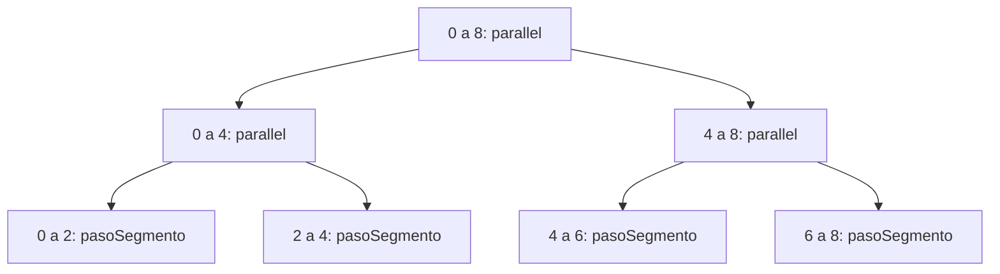

# Informe de paralelización: simulación de partículas

## La estrategia de reparto

El sistema es un arreglo de `n` partículas. `pasoParalelo` lo parte por la mitad en `mitad = desde + (hasta - desde) / 2` y entrega las dos mitades a `parallel`. Cada mitad se resuelve sin mirar la otra: un tramo va de `desde` a `mitad` y el otro de `mitad` a `hasta`, así que ningún índice aparece en los dos y ninguno se queda por fuera. Cuando el tramo tiene `umbral` elementos o menos, ya no se parte y se resuelve en secuencial con `pasoSegmento`.

El mismo esquema se usa en las tres funciones repartidas. Lo único que cambia es qué devuelve cada hoja y cómo se combinan las dos mitades:

| Función | Resultado de una hoja | Operación que combina |
|---|---|---|
| `pasoParalelo` | arreglo con las partículas movidas | concatenación `izq ++ der` |
| `energiaParalela` | suma de $\tfrac12 m v^2$ del tramo | suma `izq + der` |
| `centroDeMasaParalelo` | par (suma ponderada, masa) del tramo | suma componente a componente |

En `centroDeMasaParalelo` no se combinan promedios. Cada hoja devuelve la suma ponderada $\sum m_i \vec r_i$ y la masa $\sum m_i$, las dos mitades se suman por separado y la división se hace una sola vez al final:

$$
\vec r_{cm} = \frac{\sum_{i=0}^{n-1} m_i \vec r_i}{\sum_{i=0}^{n-1} m_i}
= \frac{\left(\sum_{i=0}^{k-1} m_i \vec r_i\right) + \left(\sum_{i=k}^{n-1} m_i \vec r_i\right)}{\left(\sum_{i=0}^{k-1} m_i\right) + \left(\sum_{i=k}^{n-1} m_i\right)}
$$

Las tres operaciones que combinan son asociativas. La suma de números y la suma de vectores lo son, y la concatenación también: $(A \mathbin{++} B) \mathbin{++} C = A \mathbin{++} (B \mathbin{++} C)$. Por eso el orden en que terminen las dos mitades no cambia el resultado. En `pasoParalelo` además se conserva el orden de las partículas, porque `parallel` devuelve la pareja en el orden en que se pasaron los llamados, sin importar cuál terminó primero.

El árbol de llamados para ocho partículas con umbral 2, con las hojas resolviendo en secuencial:



Con la regla de partir por la mitad mientras el tramo supere el umbral, el número de hojas (tramos que se resuelven en secuencial) es una potencia de dos que depende del umbral. Eso se usa más abajo: umbrales distintos pueden producir exactamente el mismo árbol.

## Cómo se tomaron los tiempos

Cada cifra sale de ScalaMeter, la librería con que mide el curso. La función `medir` ejecuta `withWarmer(new Warmer.Default) measure { ... }`, que repite el bloque hasta que la máquina virtual se estabiliza y solo entonces mide. Cada configuración se midió mediante cinco muestras obtenidas con ScalaMeter y se reportó la mediana de los tiempos como valor representativo. También se calculó la desviación estándar de las cinco muestras, con el fin de describir su dispersión respecto al promedio. Los tiempos se expresan en milisegundos.

```scala
def muestrear[A](repeticiones: Int)(cuerpo: => A): Vector[Double] =
  Vector.fill(repeticiones) {
    (withWarmer(new Warmer.Default) measure { cuerpo }).value
  }

def mediana(v: Vector[Double]): Double = v.sorted.apply(v.length / 2)
```

La máquina reporta **8 núcleos** disponibles (`Runtime.availableProcessors`, que cuenta núcleos lógicos). El sistema grande tiene $n = 1\,000\,000$ partículas y el pequeño $n = 4\,000$. En los dos, cada partícula tiene velocidad $(1; 2)$, masa 1 y $dt = 0{,}01$.

`pasoSecuencial` y `pasoParalelo` hacen el mismo trabajo de la misma forma: las dos terminan en `pasoSegmento`, que corta el tramo con `slice` y lo recorre con `map`. La diferencia de tiempos es entonces la del reparto y no la de dos operaciones distintas. La medición con el umbral igual al tamaño del sistema sirve de **control**: ahí no se parte nada y la aceleración tiene que dar 1.

Cada experimento mide el secuencial **dos veces**, al principio y al final de la corrida. Si los dos valores se separan mucho, la máquina se movió durante la corrida y las aceleraciones calculadas con el primero no son confiables.

## Qué corrida se usa

El programa se ejecutó tres veces, con la misma lista de umbrales. Esta tabla compara las tres con los dos criterios que da el enunciado: que el control dé 1 y que el secuencial del principio se parezca al del final.

| Sistema | Corrida | Secuencial inicial (ms) | Secuencial final (ms) | Aceleración del control |
|---|---|---:|---:|---:|
| Grande | C1 | 37,48 | 18,50 | 1,79 |
| Grande | **C2** | 22,79 | 18,06 | **1,13** |
| Grande | C3 | 37,41 | 23,36 | 0,78 |
| Pequeño | C1 | 0,0391 | 0,1873 | 0,21 |
| Pequeño | C2 | 0,0547 | 0,0557 | 1,37 |
| Pequeño | **C3** | 0,0418 | 0,0395 | **0,98** |

Las tablas de resultados usan la **corrida C2 para el sistema grande** y la **corrida C3 para el pequeño**. Para el sistema grande se seleccionó la corrida C2, cuyo control presentó una aceleración de 1,13, la más cercana a 1 entre las tres ejecuciones. Para el sistema pequeño se seleccionó C3, con una aceleración de control de 0,98. La selección se realizó considerando la proximidad del control a 1 y la estabilidad de las mediciones secuenciales. Las otras dos corridas se conservan en esta tabla para que se vea hasta dónde se mueve la medida: en el sistema grande el control varía de 0,78 a 1,79 con el mismo código.

## Las mediciones

### Sistema grande ($n = 1\,000\,000$, corrida C2)

Secuencial: 22,79 ms (desviación 41,63) al inicio y 18,06 ms al final. La columna *Particiones* es el número de tramos que se resuelven en secuencial.

| Umbral | Particiones | Paralela (ms) | Desv. | Aceleración | Aceleración estimada |
|---:|---:|---:|---:|---:|---:|
| 1 | 1 000 000 | 70,08 | 46,78 | 0,33 | 8,00 |
| 100 | 16 384 | 23,48 | 81,01 | 0,97 | 8,00 |
| 250 | 4 096 | 18,00 | 0,62 | 1,27 | 7,98 |
| 500 | 2 048 | 130,86 | 69,13 | 0,17 | 7,97 |
| 750 | 2 048 | 18,45 | 89,53 | 1,24 | 7,97 |
| 1 000 | 1 024 | 18,15 | 92,77 | 1,26 | 7,94 |
| 1 500 | 1 024 | 66,61 | 66,51 | 0,34 | 7,94 |
| 2 000 | 512 | 24,45 | 27,26 | 0,93 | 7,88 |
| 2 500 | 512 | 18,91 | 63,43 | 1,21 | 7,88 |
| 3 000 | 512 | 18,28 | 50,86 | 1,25 | 7,88 |
| 4 000 | 256 | 15,67 | 53,22 | 1,45 | 7,76 |
| 5 000 | 256 | 74,38 | 39,67 | 0,31 | 7,76 |
| 7 500 | 256 | 76,91 | 52,79 | 0,30 | 7,76 |
| 10 000 | 128 | **15,53** | 3,15 | **1,47** | 7,53 |
| **1 000 000 (control)** | 1 | 20,13 | 3,32 | **1,13** | 0,89 |

### Sistema pequeño ($n = 4\,000$, corrida C3)

Secuencial: 0,0418 ms (desviación 0,0104) al inicio y 0,0395 ms al final.

| Umbral | Particiones | Paralela (ms) | Desv. | Aceleración | Aceleración estimada |
|---:|---:|---:|---:|---:|---:|
| 1 | 4 000 | 0,3874 | 0,0285 | 0,11 | 7,80 |
| 10 | 512 | 0,1341 | 0,0217 | 0,31 | 7,74 |
| 50 | 128 | 0,1059 | 0,0046 | 0,39 | 7,42 |
| 100 | 64 | 0,0968 | 0,0212 | 0,43 | 7,03 |
| 250 | 16 | 0,0921 | 0,0099 | 0,45 | 5,31 |
| 500 | 8 | 0,0886 | 0,0193 | 0,47 | 3,99 |
| 1 000 | 4 | 0,0820 | 0,0157 | 0,51 | 2,66 |
| 2 000 | 2 | 0,0650 | 0,0145 | 0,64 | 1,60 |
| **4 000 (control)** | 1 | 0,0425 | 0,0046 | **0,98** | 0,89 |

## Lo que dicen los números

### El control

En la corrida elegida, el control da 1,13 en el sistema grande y 0,98 en el pequeño. Con el umbral igual al tamaño no se parte nada y `pasoParalelo` hace lo mismo que `pasoSecuencial`, así que las dos versiones hacen el mismo trabajo y la comparación mide el reparto. La diferencia del 13 % del sistema grande es el ruido de la medida, y como se ve en la tabla de corridas, en otras ejecuciones del mismo código ese control dio 0,78 y 1,79. Esa es la escala del ruido de esta máquina, y hay que tenerla presente al leer cualquier fila.

### Cuánto ruido hay: umbrales distintos que dan el mismo árbol

Con $n = 1\,000\,000$, algunos umbrales producen exactamente el mismo reparto, porque los tramos que quedan al partir por la mitad son de 977, 1 953 o 3 906 elementos y cualquier umbral que quede entre dos de esos tamaños corta en el mismo punto. Para esos grupos el cálculo es idéntico, y las diferencias de tiempo no pueden venir del umbral:

| Grupo | Umbral | Particiones | C1 (ms) | C2 (ms) | C3 (ms) |
|---|---:|---:|---:|---:|---:|
| A | 500 | 2 048 | 22,98 | 130,86 | 19,77 |
| A | 750 | 2 048 | 18,80 | 18,45 | 18,38 |
| B | 1 000 | 1 024 | 23,28 | 18,15 | 16,57 |
| B | 1 500 | 1 024 | 141,86 | 66,61 | 126,57 |
| C | 2 000 | 512 | 15,83 | 24,45 | 95,61 |
| C | 2 500 | 512 | 16,52 | 18,91 | 17,73 |
| C | 3 000 | 512 | 62,48 | 18,28 | 16,01 |
| D | 4 000 | 256 | 86,12 | 15,67 | 85,14 |
| D | 5 000 | 256 | 15,52 | 74,38 | 17,89 |
| D | 7 500 | 256 | 72,57 | 76,91 | 18,91 |

El mismo cálculo da 15,5 ms en una fila y 141,9 ms en otra. Por ejemplo, el grupo D hace exactamente lo mismo con los tres umbrales y da entre 15,5 y 86,1 ms. Esto prueba que los picos de 60 a 140 ms son ruido de la ejecución y no una propiedad del umbral. La desviación lo confirma: en el sistema grande es de 30 a 90 ms sobre medianas de unos 18 ms, lo que significa que alguna de las cinco mediciones de la fila fue de más de 100 ms. La mediana de cinco ignora uno o dos picos pero no tres, y en las filas de 60 a 140 ms fueron al menos tres. La causa más probable es el recolector de basura, porque cada paso crea millones de objetos pequeños (una `Particula` y dos `Vector2` por partícula), pero no se midió.

Las filas con desviación pequeña son las que tuvieron las cinco mediciones limpias, y son las más confiables: 250 (18,00 ms ± 0,62) y 10 000 (15,53 ms ± 3,15) en C2, y 5 000 (15,52 ms ± 0,60) en C1. Todas caen entre 15,5 y 18 ms.

### Umbral muy pequeño

Con umbral 1 el tiempo paralelo es de 70 ms en C1 y C2 y de 58 ms en C3, entre dos y tres veces el secuencial. Partir hasta tramos de un elemento crea un millón de hojas, cada una con su arreglo, y ese costo es mayor que el cálculo que reparte: mover una partícula es una suma y un producto. En el sistema pequeño pasa lo mismo con más claridad: con umbral 1 la aceleración es 0,11, unas nueve veces más lento que el secuencial.

### La zona donde conviene

Los tiempos limpios del sistema grande están todos entre 15,5 y 18 ms desde el umbral 250 hasta el 10 000. Dentro de esa zona el umbral no se distingue del ruido, y el programa lo confirma: `umbralConveniente` devolvió 4 000, 3 000 y 2 500 en las tres corridas, tres respuestas distintas dentro de la misma meseta. Se recomienda utilizar un umbral de 10.000 partículas para el sistema de un millón de partículas, ya que en la corrida seleccionada presentó uno de los mejores tiempos: 15,53 ms, con una desviación estándar de 3,15 ms y una aceleración de 1,47. Sin embargo, los resultados muestran una zona de rendimiento similar entre varios umbrales, por lo que no se puede afirmar que 10.000 sea un óptimo universal. El valor debe considerarse una elección conveniente dentro de las configuraciones evaluadas.

### El sistema pequeño

Con 4 000 partículas el paso completo cuesta 0,04 ms, y **repartir no conviene con ningún umbral**: la aceleración va de 0,11 a 0,64 y solo el control llega a 1. La aceleración crece al reducir el número de particiones (0,11 con 4 000, 0,43 con 64, 0,64 con 2) porque cada partición agrega llamados y arreglos que cuestan más que los pocos cientos de operaciones del tramo. El tiempo de crear tareas es el mismo que con un millón de partículas, pero aquí no hay cálculo suficiente para pagarlo. Los tiempos por debajo de 0,1 ms están cerca de lo que resuelve el reloj, y por eso el mismo control dio 0,21, 1,37 y 0,98 en las tres corridas.

### La medición contra la estimación

La estimación del punto 4 y la medición coinciden en una sola cosa: el control. De ahí en adelante se separan. Para el sistema grande, la estimación predice una aceleración de 7,5 a 8,0 con cualquier umbral entre 1 y 10 000, y la medición limpia da entre 1,2 y 1,5, en 8 núcleos. Para el pequeño predice hasta 7,8 y la medición da entre 0,11 y 0,64. Tampoco coincide la forma: la estimación dice que umbral 1 es el mejor (8,00 y 7,80) y la medición dice que es el peor en los dos tamaños.

La estimación cuenta operaciones y supone dos cosas que no se cumplen aquí. La primera es que repartir no cuesta: cada hoja crea su propio arreglo, y cada nivel del árbol concatena con `izq ++ der`, que copia los resultados de sus dos mitades. La concatenación de la raíz copia un millón de referencias en un solo hilo, la del siguiente nivel copia medio millón en cada mitad, y así sigue. Esas copias suman del orden de $2n$ elementos a lo largo del camino crítico, una cantidad proporcional a $n$, mientras que la profundidad del punto 4 cuenta solo $\log n$ llamados más el tramo de una hoja. La segunda es que la memoria no es un límite: `mover` crea un `Vector2` para la posición nueva, otro por la multiplicación y una `Particula` por cada elemento, además del `slice` y del `map` del tramo. Son muchas escrituras en una memoria que los ocho núcleos comparten, y más núcleos no las reparten. Estas dos explicaciones son coherentes con el código y con los números, pero no se comprobaron con un perfilador.

La estimación sirve como techo y para ver que un umbral demasiado pequeño tiene costo, no como pronóstico del reloj.

### El techo de la aceleración

Con la ley de Amdahl, para $p = 8$ núcleos y una aceleración medida $S$, la fracción $f$ del cálculo que corre en serie es:

$$
S(p) = \frac{1}{f + \frac{1 - f}{p}}
\qquad\Longrightarrow\qquad
f = \frac{\frac{1}{S} - \frac{1}{p}}{1 - \frac{1}{p}}
$$

La mejor fila limpia del sistema grande es el umbral 10 000, con 15,53 ms. Contra el secuencial del inicio de la corrida (22,79 ms) da $S = 1{,}47$, y contra el del final (18,06 ms) da $S = 1{,}16$. Como la máquina se movió entre los dos, se usan los dos valores como extremos:

| $S$ medida | $f$ | Techo $1/f$ |
|---:|---:|---:|
| 1,47 | 0,63 | 1,58 |
| 1,16 | 0,84 | 1,19 |

Entre el 63 % y el 84 % del tiempo corre en serie, o en algo que no se reparte entre los núcleos. La aceleración máxima según el número de núcleos queda así:

| $p$ | 2 | 4 | 8 | 16 | 32 | $\infty$ |
|---|---:|---:|---:|---:|---:|---:|
| Con $f = 0{,}63$ | 1,22 | 1,38 | 1,47 | 1,52 | 1,55 | 1,58 |
| Con $f = 0{,}84$ | 1,09 | 1,13 | 1,16 | 1,17 | 1,18 | 1,19 |

En este cálculo, pasar de 8 a 32 núcleos agregaría entre 0,02 y 0,08 a la aceleración, menos que el ruido de la medida. Esta $f$ no es la fracción de código que `parallel` no toca, que es mínima: es todo lo que no mejora con más núcleos, es decir la concatenación, el acceso a una memoria compartida y la recolección de basura, y por eso es tan alta.

## Conclusiones

1. El reparto está bien hecho: la partición no pierde ni repite elementos, la operación que combina es asociativa y el control da 1 dentro del ruido (1,13 y 0,98).
2. Un umbral demasiado pequeño perjudica en los dos tamaños: con umbral 1 el paralelo es de 0,33 a 0,65 veces la velocidad del secuencial con un millón de partículas y 0,11 con cuatro mil.
3. El umbral conveniente para un millón de partículas es **10 000**. Entre 250 y 10 000 los tiempos limpios son de 15,5 a 18 ms y el umbral no se distingue del ruido. Con cuatro mil partículas no conviene repartir.
4. La aceleración medida en 8 núcleos queda entre 1,2 y 1,5, muy por debajo del 7,5 que predice la estimación. La causa probable es que se reparte un cálculo muy barato por elemento, y el costo de crear y copiar arreglos pesa más que el cálculo. El techo de Amdahl con estos datos es de 1,2 a 1,6 por muchos núcleos que se agreguen.
5. Las mediciones de esta máquina tienen mucho ruido: el mismo cálculo dio entre 15,5 y 141,9 ms, y el secuencial varió entre 18 y 37 ms. Por eso las conclusiones se apoyan en las filas limpias (desviación pequeña) y en la comparación entre corridas, y no en un tiempo aislado.
