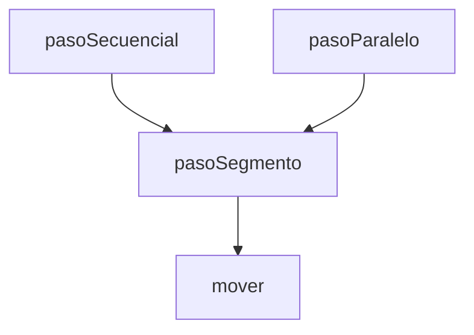
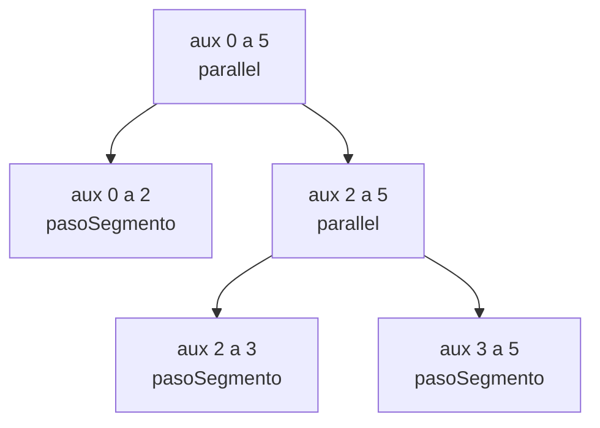
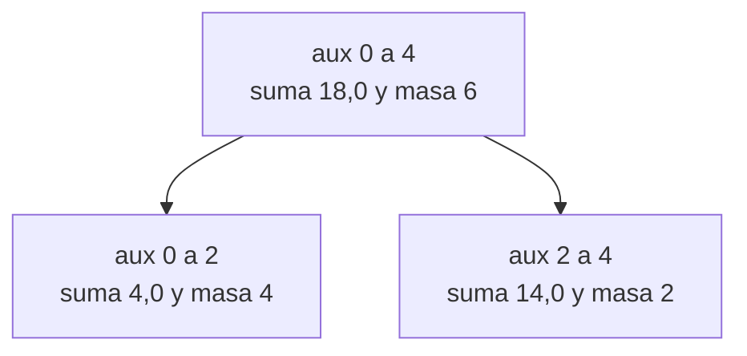
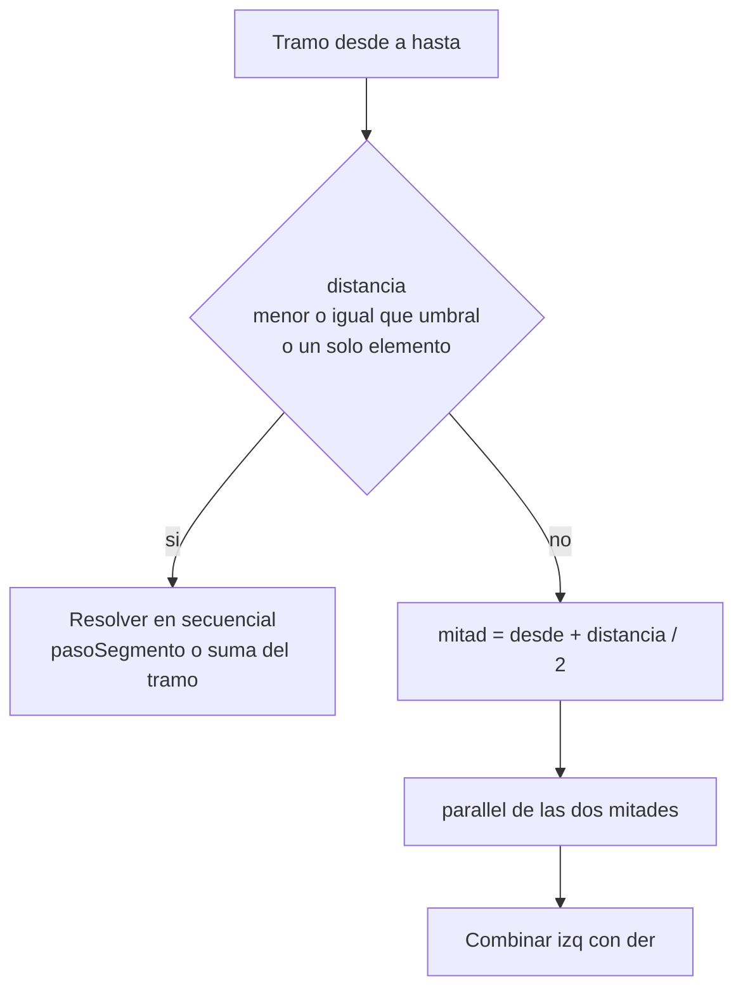

# Informe de proceso: simulación de partículas en paralelo

Este informe explica, paso a paso, cómo se ejecuta cada función del taller, cómo se reparte el trabajo y cómo se combinan los resultados parciales. Todas las funciones están en la clase `SimulacionParticulas`. Siguen el estilo funcional del curso: sin variables mutables, sin ciclos `for` o `while` y sin `return`. Las funciones auxiliares (`aux`) están definidas dentro de la función que las usa.

## 1. Mapa general

| Punto | Función | Qué hace | Se reparte | Cómo se combina |
|---|---|---|---|---|
| 1 | `mover` | calcula la partícula después de un paso | no | no aplica |
| 1 | `pasoSegmento` | avanza el tramo `[desde, hasta)` | no | no aplica |
| 1 | `pasoSecuencial` | avanza todo el sistema | no | no aplica |
| 1 | `pasoParalelo` | avanza todo el sistema, partiéndolo | sí | concatenación `izq ++ der` |
| 2 | `energiaSecuencial` | suma las energías cinéticas | no | no aplica |
| 2 | `masaTotal` | suma las masas | no | no aplica |
| 2 | `centroDeMasaSecuencial` | centro de masa del sistema | no | no aplica |
| 3 | `energiaParalela` | energía, partiendo el sistema | sí | suma de dos números |
| 3 | `centroDeMasaParalelo` | centro de masa, partiendo el sistema | sí | suma de dos pares (suma ponderada, masa) |
| 4 | `trabajo`, `profundidad`, `tiempoEstimado` | estiman el costo sin ejecutar | no | no aplica |
| 5 | `medir`, `aceleracion`, `umbralConveniente` | miden y comparan tiempos | no | no aplica |

El modelo de datos es el que entrega el material y no se modifica:

```scala
case class Vector2(x: Double, y: Double)            // suma (+), producto por escalar (*), norma
case class Particula(pos: Vector2, vel: Vector2, masa: Double)
type Sistema = Array[Particula]
```

Para repartir se usa `parallel(a, b)`, de la librería `common`: evalúa las dos expresiones, que pueden correr en hilos distintos, y devuelve la pareja de resultados cuando las dos terminaron, **en el orden en que se escribieron**. Ese orden es lo que permite que el resultado no dependa de cuál mitad termina primero.

## 2. Punto 1: un paso de la simulación

### 2.1. Cómo se llaman entre sí



Las dos versiones terminan en la misma pieza, `pasoSegmento`, que a su vez usa `mover`. Por eso la versión secuencial y la paralela hacen el mismo trabajo por partícula, y la única diferencia entre ellas es el reparto.

### 2.2. `mover`

Recibe una partícula `p` y el paso `dt`, y devuelve una copia con la posición nueva: `p.pos + p.vel * dt`. La velocidad y la masa quedan como estaban porque `copy` solo cambia el campo `pos`.

Ejemplo con $dt = 2$ y una partícula en $(2, 0)$ con velocidad $(1, 2)$:

1. `p.vel * dt` da $(1, 2) \cdot 2 = (2, 4)$.
2. `p.pos + (2, 4)` da $(2, 0) + (2, 4) = (4, 4)$.
3. El resultado es una partícula nueva en $(4, 4)$ con velocidad $(1, 2)$ y la misma masa. La original no se toca.

### 2.3. `pasoSegmento`

1. `s.slice(desde, hasta)` toma el tramo de `desde` incluido a `hasta` excluido y lo copia en un arreglo nuevo.
2. `.map(q => mover(q, dt))` aplica `mover` a cada partícula del tramo, en orden.

Si `desde >= hasta` el tramo está vacío y el resultado es un arreglo vacío.

### 2.4. `pasoSecuencial`

Llama a `pasoSegmento(s, dt, 0, s.length)`: el tramo es el sistema entero.

Ejemplo que se usa en toda esta sección: cinco partículas $P_0, \dots, P_4$ con $P_i$ en $(i, 0)$, velocidad $(1, i)$ y masa 1, con $dt = 2$. Como la posición nueva es $(i + 2,\ 2i)$, el resultado es:

| Partícula | Posición antes | Velocidad | Posición después |
|---|---|---|---|
| $P_0$ | $(0, 0)$ | $(1, 0)$ | $(2, 0)$ |
| $P_1$ | $(1, 0)$ | $(1, 1)$ | $(3, 2)$ |
| $P_2$ | $(2, 0)$ | $(1, 2)$ | $(4, 4)$ |
| $P_3$ | $(3, 0)$ | $(1, 3)$ | $(5, 6)$ |
| $P_4$ | $(4, 0)$ | $(1, 4)$ | $(6, 8)$ |

### 2.5. `pasoParalelo`

Recibe el sistema, `dt` y el `umbral`. Define una función interna `aux(desde, hasta)` y la llama con `aux(0, s.length)`. Cada llamada de `aux` hace lo siguiente:

1. Calcula `distancia = hasta - desde`.
2. **Caso base:** si `distancia <= umbral` (o si el tramo tiene un solo elemento), el tramo ya no se parte y se resuelve con `pasoSegmento(s, dt, desde, hasta)`.
3. **Caso recursivo:** calcula `mitad = desde + distancia / 2` y entrega a `parallel` los dos llamados, `aux(desde, mitad)` y `aux(mitad, hasta)`. Cuando los dos terminan, los une con `izq ++ der`.

La condición del tramo de un solo elemento hace que el reparto termine incluso con `umbral = 0`. Sin ella, un tramo de un elemento daría `mitad = desde` y `aux(desde, hasta)` se llamaría a sí misma con los mismos argumentos.

Traza con el ejemplo de cinco partículas y `umbral = 2`:

| Llamado | Tramo | Distancia | ¿Se parte? | Qué hace |
|---|---|---:|---|---|
| `aux(0, 5)` | $[0, 5)$ | 5 | sí, `mitad = 0 + 5/2 = 2` | `parallel(aux(0, 2), aux(2, 5))` |
| `aux(0, 2)` | $[0, 2)$ | 2 | no | `pasoSegmento` da $[P_0', P_1']$ |
| `aux(2, 5)` | $[2, 5)$ | 3 | sí, `mitad = 2 + 3/2 = 3` | `parallel(aux(2, 3), aux(3, 5))` |
| `aux(2, 3)` | $[2, 3)$ | 1 | no | `pasoSegmento` da $[P_2']$ |
| `aux(3, 5)` | $[3, 5)$ | 2 | no | `pasoSegmento` da $[P_3', P_4']$ |

(Con $P_i'$ se escribe la partícula $P_i$ ya movida.)



**Cómo se reparte.** Los tres tramos que se resuelven en secuencial (las hojas) son $[0, 2)$, $[2, 3)$ y $[3, 5)$. Juntos cubren $[0, 5)$ sin dejar ningún índice por fuera y sin repetir ninguno, porque cada partición produce un tramo que termina donde empieza el siguiente. Las hojas no tienen por qué ser del mismo tamaño: cuando la distancia es impar, la mitad derecha queda con un elemento más.

**Cómo se combina.** De abajo hacia arriba:

1. `aux(2, 5)` devuelve $[P_2'] \mathbin{++} [P_3', P_4'] = [P_2', P_3', P_4']$.
2. `aux(0, 5)` devuelve $[P_0', P_1'] \mathbin{++} [P_2', P_3', P_4'] = [P_0', P_1', P_2', P_3', P_4']$.

El resultado tiene las cinco partículas movidas y en el mismo orden que el sistema original, igual que el de `pasoSecuencial`.

## 3. Punto 2: magnitudes globales en secuencial

Para este punto y el siguiente se usa un sistema de cuatro partículas:

| Partícula | Posición | Velocidad | Norma de la velocidad | Masa |
|---|---|---|---:|---:|
| $A$ | $(0, 0)$ | $(3, 4)$ | 5 | 2 |
| $B$ | $(2, 0)$ | $(0, 0)$ | 0 | 2 |
| $C$ | $(4, 0)$ | $(0, 2)$ | 2 | 1 |
| $D$ | $(10, 0)$ | $(0, 4)$ | 4 | 1 |

### 3.1. `energiaSecuencial`

1. `s.map { ... }` calcula para cada partícula $\tfrac12 \cdot m \cdot \lVert v \rVert \cdot \lVert v \rVert$.
2. `.sum` suma esos valores.

Ejemplo: las energías son $A$: $0{,}5 \cdot 2 \cdot 5 \cdot 5 = 25$; $B$: $0$; $C$: $0{,}5 \cdot 1 \cdot 2 \cdot 2 = 2$; $D$: $0{,}5 \cdot 1 \cdot 4 \cdot 4 = 8$. La suma es $25 + 0 + 2 + 8 = 35{,}0$. Con un sistema vacío no hay nada que sumar y el resultado es $0{,}0$.

### 3.2. `masaTotal`

`s.map(q => q.masa).sum` toma la masa de cada partícula y las suma. Ejemplo: $2 + 2 + 1 + 1 = 6{,}0$.

### 3.3. `centroDeMasaSecuencial`

1. Calcula `Totalmasa = masaTotal(s)`.
2. Si es cero, devuelve el origen $(0, 0)$, porque no se puede dividir entre cero.
3. Si no, calcula la suma de las posiciones ponderadas por la masa: `s.map(p => p.pos * p.masa).foldLeft(Vector2(0, 0))(_ + _)`.
4. Multiplica esa suma por `1.0 / Totalmasa`, que es dividir entre la masa total.

Ejemplo: las posiciones ponderadas son $A$: $(0, 0)$, $B$: $(4, 0)$, $C$: $(4, 0)$ y $D$: $(10, 0)$. El `foldLeft` arranca en $(0, 0)$ y acumula $(0,0) \to (0,0) \to (4,0) \to (8,0) \to (18,0)$. El resultado es $(18, 0) \cdot \tfrac{1}{6} = (3{,}0;\ 0{,}0)$.

## 4. Punto 3: las mismas magnitudes en paralelo

Las dos funciones repartidas usan el mismo esquema de `pasoParalelo`: una `aux(desde, hasta)` que parte el tramo por la mitad con `parallel` mientras la distancia supere el `umbral`, y que en las hojas resuelve en secuencial. Con el sistema de la sección anterior y `umbral = 2`, las hojas son $[0, 2)$ (con $A$ y $B$) y $[2, 4)$ (con $C$ y $D$).

### 4.1. `energiaParalela`

- **Hoja:** suma las energías de las partículas del tramo.
- **Combinar:** suma los dos números, `izq + der`.

| Llamado | Tramo | Resultado |
|---|---|---:|
| `aux(0, 2)` | $A$ y $B$ | $25 + 0 = 25{,}0$ |
| `aux(2, 4)` | $C$ y $D$ | $2 + 8 = 10{,}0$ |
| `aux(0, 4)` | combina | $25{,}0 + 10{,}0 = 35{,}0$ |

El resultado coincide con el de `energiaSecuencial`.

### 4.2. `centroDeMasaParalelo`

Aquí `aux` no devuelve un centro de masa sino un **par** (suma ponderada, masa):

- **Hoja:** calcula la suma de `pos * masa` del tramo (con un `foldLeft` desde el origen) y la masa del tramo, y devuelve ambas.
- **Combinar:** suma las dos sumas ponderadas y suma las dos masas, `(izq._1 + der._1, izq._2 + der._2)`.
- **Al final:** `centroDeMasaParalelo` recibe el par de la raíz, devuelve el origen si la masa es cero y, si no, divide una sola vez.



| Llamado | Tramo | Suma ponderada | Masa |
|---|---|---|---:|
| `aux(0, 2)` | $A$ y $B$ | $(0,0) + (4,0) = (4, 0)$ | 4 |
| `aux(2, 4)` | $C$ y $D$ | $(4,0) + (10,0) = (14, 0)$ | 2 |
| `aux(0, 4)` | combina | $(4 + 14,\ 0) = (18, 0)$ | $4 + 2 = 6$ |

Después de la raíz, la división única da $(18, 0) \cdot \tfrac{1}{6} = (3{,}0;\ 0{,}0)$, igual que `centroDeMasaSecuencial`.

**Por qué no se promedia en cada mitad.** El centro de masa de la mitad izquierda es $(4, 0)/4 = (1, 0)$ y el de la derecha es $(14, 0)/2 = (7, 0)$. Promediar esos dos daría $(4, 0)$, que es distinto del resultado correcto $(3, 0)$, porque las dos mitades no pesan lo mismo (masa 4 contra masa 2). Llevando la suma ponderada y la masa por separado, cada mitad pesa lo que le corresponde.

**Nota sobre los decimales.** El orden en que se suman los números cambia entre la versión secuencial y la paralela, y con números decimales eso puede alterar las últimas cifras. Por eso las pruebas comparan con una tolerancia pequeña y no con igualdad exacta.

## 5. Punto 4: trabajo y profundidad

Estas tres funciones no ejecutan la simulación: solo calculan una estimación a partir de $n$ (partículas), $p$ (procesadores) y el `umbral`.

### 5.1. `trabajo`

Devuelve `n`: una operación por partícula. No baja por repartirlo, porque repartir no elimina operaciones.

### 5.2. `profundidad`

Cuenta cuántas veces se parte el sistema a la mitad hasta llegar al umbral, más el trabajo del tramo que queda sin partir:

1. Si `n <= umbral` (o `n <= 1`), devuelve `n`: es el tramo que se resuelve en secuencial.
2. Si no, devuelve `1 + profundidad((n + 1) / 2, umbral)`: una partición más, sobre la mitad más grande.

Se usa `(n + 1) / 2`, la mitad más grande, porque la profundidad es la del camino más largo, y ese es el que pasa por el tramo más grande.

Traza de `profundidad(100, 10)`:

| Llamado | $n$ | ¿$n \le 10$? | Resultado |
|---|---:|---|---|
| `profundidad(100, 10)` | 100 | no | $1 + $ `profundidad(50, 10)` |
| `profundidad(50, 10)` | 50 | no | $1 + $ `profundidad(25, 10)` |
| `profundidad(25, 10)` | 25 | no | $1 + $ `profundidad(13, 10)` |
| `profundidad(13, 10)` | 13 | no | $1 + $ `profundidad(7, 10)` |
| `profundidad(7, 10)` | 7 | sí | $7$ |

Subiendo por la pila: $1 + 1 + 1 + 1 + 7 = 11$.

### 5.3. `tiempoEstimado`

Calcula `profundidad(n, umbral) + trabajo(n) / p`, con la división hecha en `Double`. La profundidad es la parte que no se reparte entre procesadores y el trabajo entre $p$ es la parte que sí.

Ejemplo con $n = 100$, $p = 4$ y umbral 10: $11 + 100/4 = 36{,}0$. La aceleración estimada es $100 / 36 \approx 2{,}78$.

## 6. Punto 5: medir la aceleración

### 6.1. `medir`

Recibe el número de repeticiones y un bloque, y devuelve la mediana de los tiempos:

1. `Vector.fill(repeticiones) { ... }` repite la medición; en cada una, `withWarmer(new Warmer.Default) measure { cuerpo }` calienta la máquina virtual hasta que se estabiliza y solo entonces mide, y `.value` es el tiempo en milisegundos.
2. `muestras.sorted.apply(muestras.length / 2)` ordena los tiempos y toma el del medio.

Ejemplo con cinco muestras $(18{,}2;\ 95{,}0;\ 15{,}9;\ 16{,}4;\ 17{,}1)$: ordenadas quedan $(15{,}9;\ 16{,}4;\ 17{,}1;\ 18{,}2;\ 95{,}0)$ y la posición $5/2 = 2$ es $17{,}1$. La mediana ignora el valor aislado de $95{,}0$, que es lo que haría subir un promedio.

### 6.2. `aceleracion`

Devuelve `tSecuencial / tParalelo`. Por ejemplo, $18{,}0 / 15{,}0 = 1{,}2$. Un valor mayor que 1 significa que la versión paralela fue más rápida y uno menor que 1 que fue más lenta.

### 6.3. `umbralConveniente`

1. Si la lista de umbrales está vacía, devuelve `s.length`, que equivale a no repartir.
2. Si no, convierte cada umbral en un par `(umbral, tiempo)`, donde el tiempo es `medir(3) { pasoParalelo(s, dt, umbral) }`.
3. Con `minBy(_._2)` toma el par de menor tiempo y devuelve su umbral. Si dos tiempos son iguales, se queda con el primero de la lista.

Ejemplo con tiempos $100 \to 30{,}0$ ms, $1000 \to 18{,}0$ ms y $10000 \to 15{,}5$ ms: el menor es $15{,}5$ y el resultado es $10000$.

### 6.4. Cómo los usa `App.scala`

Para cada tamaño de sistema, `App` hace lo mismo:

1. Mide el secuencial con `medir(5)`.
2. Para cada umbral de la lista, mide `pasoParalelo` con `medir(5)`, calcula la aceleración con `aceleracion` y la compara con la estimada de `tiempoEstimado`.
3. Con el umbral igual al tamaño del sistema obtiene la fila de control.
4. Vuelve a medir el secuencial al final, para detectar si la máquina se movió durante la corrida.
5. Llama a `umbralConveniente` con la misma lista.

## 7. Resumen: cómo se reparte y cómo se combina

Las tres funciones repartidas siguen el mismo proceso, y solo cambian lo que devuelve una hoja y la operación que combina:



| Función | Resultado de una hoja | Combinación | ¿Por qué es válida? |
|---|---|---|---|
| `pasoParalelo` | arreglo de partículas movidas | `izq ++ der` | la concatenación es asociativa y `parallel` conserva el orden izquierda–derecha |
| `energiaParalela` | suma de energías del tramo | `izq + der` | la suma de números es asociativa |
| `centroDeMasaParalelo` | (suma ponderada, masa) | suma componente a componente | la suma de vectores y la de masas son asociativas, y la división se hace una sola vez |

Tres propiedades se mantienen en las tres funciones y son las que hacen que el resultado paralelo coincida con el secuencial:

1. **Ningún elemento se pierde ni se repite.** Las dos mitades de un tramo $[desde, hasta)$ son $[desde, mitad)$ y $[mitad, hasta)$, y las hojas son tramos contiguos que cubren todo el sistema.
2. **Cada partícula se procesa con la misma operación**, sea en una hoja grande o pequeña, porque todas las hojas terminan en el mismo código secuencial.
3. **La operación que combina es asociativa**, y por eso el árbol de llamados puede agrupar los resultados parciales de cualquier forma sin cambiar el resultado.
